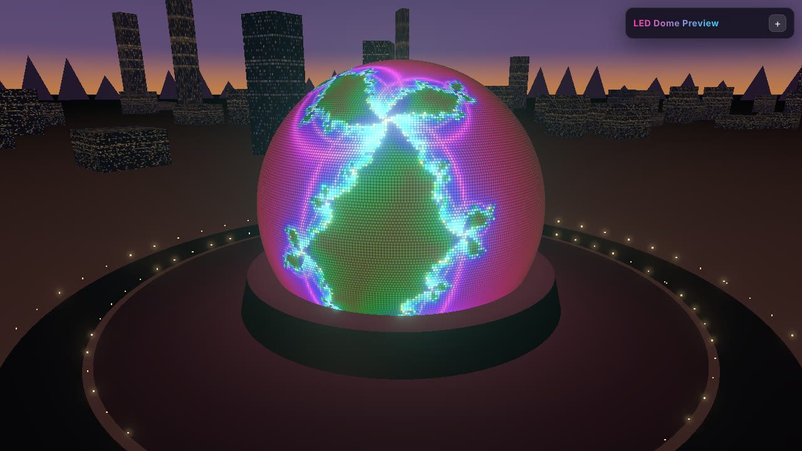
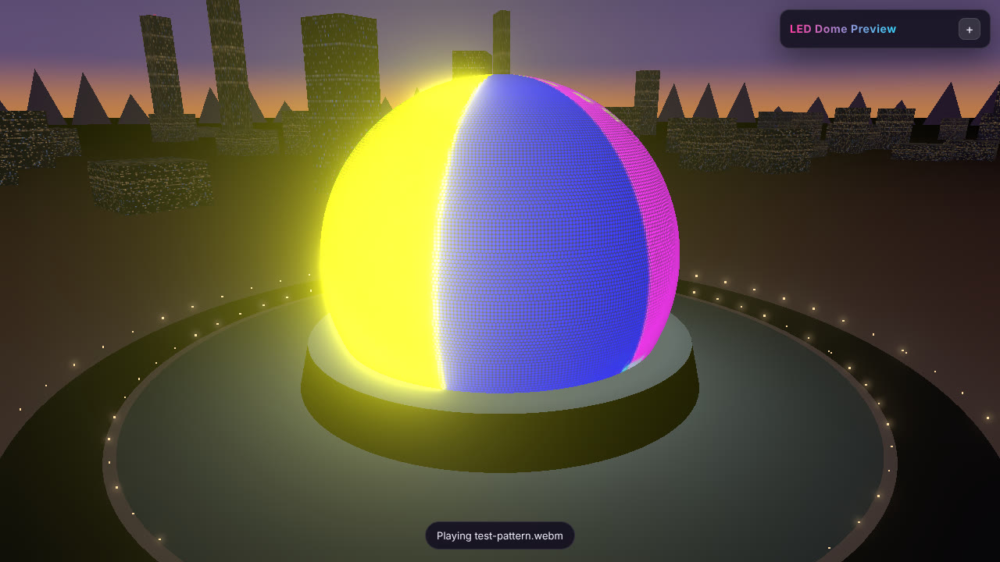
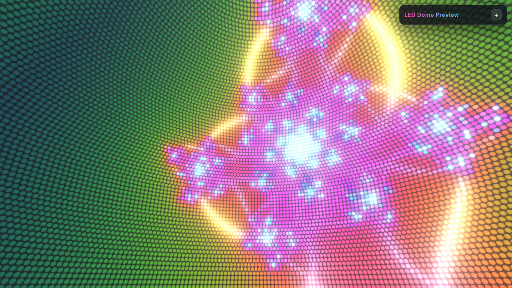
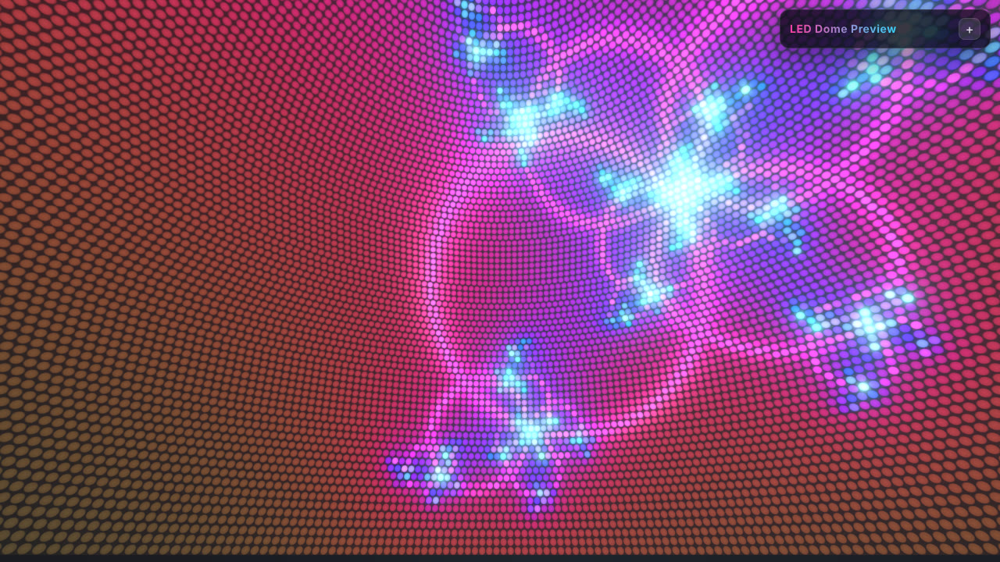
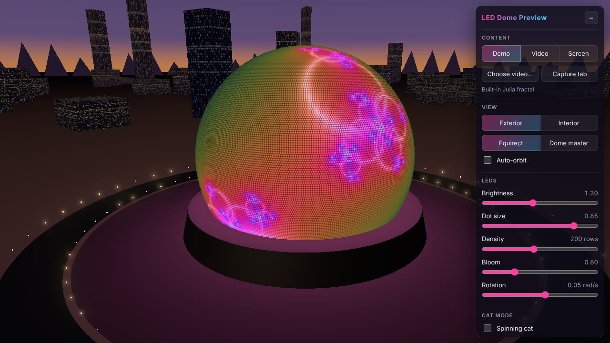
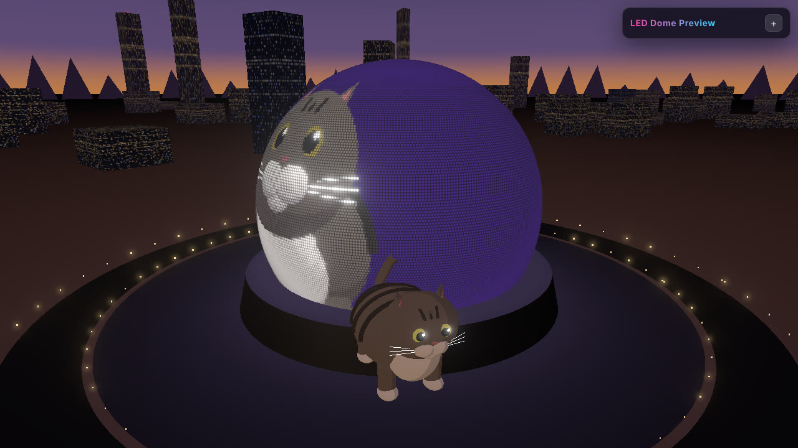
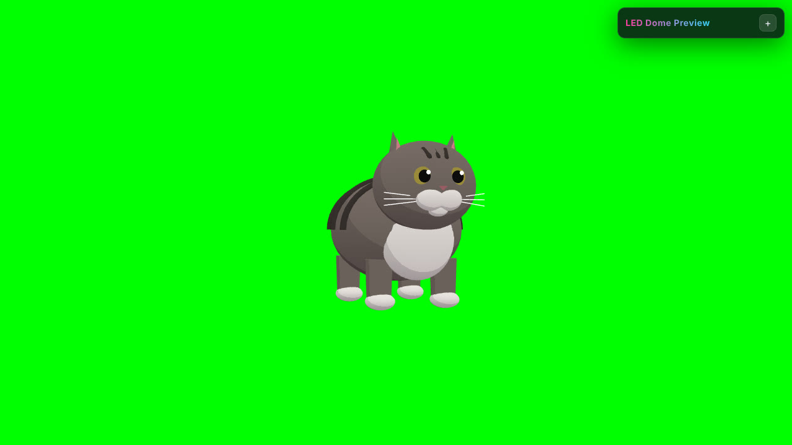

# LED Dome Preview

A visual mockup for previewing your visuals on a giant LED sphere venue at night.
It's a generic, stylized venue and doesn't use any real venue's name, logo or branding.

Built with Vite, vanilla JS and Three.js. No framework, and the gzipped bundle is about 175 KB.



| | |
| --- | --- |
|  |  |
| Your video file on the sphere | Interior view, equirect |
|  |  |
| Interior view, dome master | Control panel |
|  |  |
| Cat mode | Cat mode, green screen |

## Run

```bash
npm install
npm run dev        # http://localhost:5173
npm run build      # static site in dist/
npm run preview    # serve the production build
```

## Deploy to Vercel

The app is a plain static site, and `vercel.json` is already set up.

- **Git:** push the repo, then pick "Import Project" on vercel.com. The framework is detected as Vite, the build command is `npm run build` and the output folder is `dist`.
- **CLI:** run `npm i -g vercel`, then `vercel` (preview) or `vercel --prod`.

## Using it

| Control | What it does |
| --- | --- |
| **Demo / Video / Screen** | Built-in Julia fractal, a video file you pick or drop on the page (looped and muted), or a live tab/screen capture through `getDisplayMedia` |
| **Exterior / Interior** | Orbit around the sphere from outside, or look around from its centre |
| **Equirect / Dome master** | Read the content as a 2:1 lat-long frame or as a 180° circular fisheye (zenith in the middle) |
| **Brightness, Dot size, Density, Bloom, Rotation** | Tune the LED look and spin the content around the vertical axis |
| **Auto-orbit** | Slow idle orbit. It stops as soon as you drag; tick the box to turn it back on |
| **Cat mode** | A spinning cat plays on the sphere, and a big one spins in front of it (exterior view) |
| **Green screen** | Draws only the spinning cat, on pure `#00FF00`, so you can key it out |
| **Your audio… / Play** | Plays an audio file you pick. The cat bounces to it, and recordings include it |
| **Record 15s** | Records the canvas with MediaRecorder and downloads a `.webm` (`.mp4` on Safari) |

Screen capture needs a desktop browser; it's disabled on phones that don't support it.

### Cat assets (optional)

Put either file in `public/assets/`:

- `cat.glb`: a 3D model. It's used first if it exists.
- `cat.png`: an image, shown on a spinning card. If the image has a green-screen background, the green is keyed out automatically.

If neither file exists, the app builds its own grey tabby out of Three.js primitives. Only add files you have the rights to use. No audio is bundled.

## Project layout

```
index.html              UI panel markup
src/main.js             renderer, camera/controls, bloom, frame loop, app state
src/shaders/
  mapping.glsl.js       direction <-> uv for equirect and dome master (shared)
  ledShader.js          LED panel shader (commented)
src/scene/
  ledSphere.js          sphere mesh and uniforms
  environment.js        sky, stars, mountains, skyline, glowing ground, base
src/content/
  demoFractal.js        animated Julia set rendered to a texture
  mediaSources.js       video file and screen capture -> VideoTexture
src/cat/
  catModel.js           glb / png / procedural cat loader
  catMode.js            offscreen cat render, green screen
src/audio.js            user audio playback, level meter, recording track
src/recorder.js         Record 15s
src/ui/panel.js         panel wiring
tests/e2e.mjs           headless end-to-end check
```

### How the LED shader works

The sphere is split into latitude rows of equal height. Each row gets its own number of columns, based on its circumference, so the dots stay round and evenly spaced all the way to the poles. Each dot shows a single colour, sampled from the content at the centre of its cell, and is drawn as an anti-aliased disc on a dark panel. When dots get smaller than about 2 px, they fade to their average brightness, which avoids moiré. Bloom from the post-processing pass adds the glow.

## Tests

```bash
npm i -D playwright && npx playwright install chromium   # once
npm run build && npm run test:e2e
```

The test runs headless Chromium. It checks that the demo, video-file and screen-capture inputs each put real pixels on the sphere, that both view modes and both mappings render, that cat mode and green screen work (it checks for pure `#00FF00`), that the sliders work, and that Record 15s downloads a `.webm`. Screenshots are saved in `tests/output/`.
